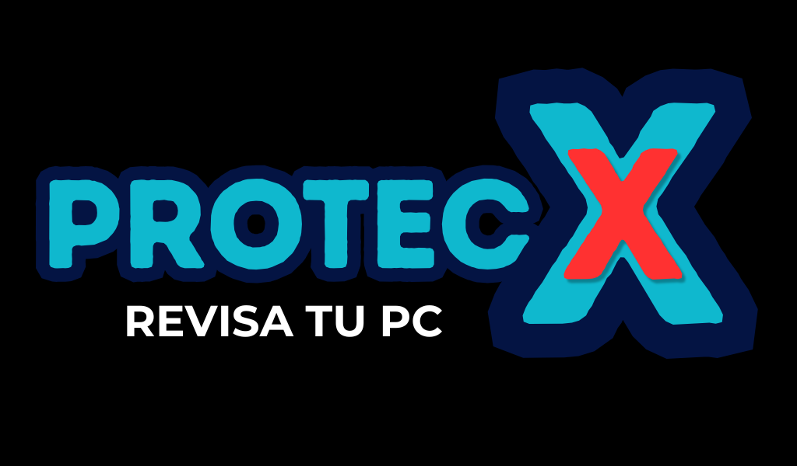

<div align="center">



### Escáner defensivo de malware, procesos, red y persistencia

**Solo lectura · Multiplataforma · Informes claros, sin jerga**


[Características](#-características) ·
[Inicio rápido](#-inicio-rápido) ·
[Uso](#-uso) ·
[Informe](#-el-informe) ·
[Firmas](#-fuentes-de-firmas) ·
[Límites](#-límites-léelos)

</div>

---

## ✨ ¿Qué es ProtecX?

ProtecX revisa tu ordenador en busca de señales de malware y te cuenta lo que encuentra **en lenguaje
normal**: qué significa, por qué importa y qué hacer. **No borra ni modifica nada**: analiza, genera un
informe (HTML + JSON) y, solo si tú lo pides, aísla un archivo de forma reversible.

| | |
|---|---|
| 🔍 **Análisis completo** | Procesos, red, persistencia, archivos y configuración del sistema |
| 🛡️ **Solo lectura** | Nunca borra, mata procesos ni toca tus archivos por su cuenta |
| 📄 **Informe autocontenido** | Un HTML que se abre con doble clic, sin servidor ni internet |
| 🆕 **Comparación entre análisis** | Marca lo **NUEVO**, lo que sigue igual y lo resuelto |
| 🧰 **Todo en uno** | Lanzador con menú: sin comandos que memorizar |
| 🔌 **Extensible** | Añadir un módulo de análisis son unas pocas líneas |

## 🔎 Características

| Módulo | Qué comprueba |
|---|---|
| **`processes`** | Hash de cada binario en ejecución · suplantación de procesos del sistema (`svchost.exe` fuera de System32) · ejecución desde `/tmp`, memoria anónima (`memfd`) o binario borrado · líneas de comandos de ataque (reverse shells, PowerShell codificado) · YARA sobre memoria (opcional) |
| **`network`** | Puertos en escucha y conexiones con su proceso · IPs y dominios de C2 conocidos · puertos típicos de backdoors · shells con conexión externa · programas en carpetas temporales hablando con Internet · *beaconing* (`--monitor`) · caché DNS (Windows) · modo promiscuo (Linux) |
| **`persistence`** | **Windows:** claves Run/Winlogon/IFEO, tareas programadas, servicios y carpeta Inicio · **Linux/macOS:** cron, systemd, `rc.local`, `ld.so.preload`, perfiles de shell, claves SSH, cuentas UID 0 · **macOS:** LaunchAgents/Daemons |
| **`files`** | Hash + reglas YARA de ejecutables y scripts · doble extensión (`factura.pdf.exe`) · ejecutables ocultos en carpetas temporales · contenido de scripts · ClamAV opcional |
| **`system`** | Archivo `hosts` (dominios maliciosos o de seguridad bloqueados) · Defender desactivado por directiva |

### Además

- **Firma digital (Windows):** valida Authenticode y ajusta la gravedad (ver [más abajo](#-firma-digital-windows)).
- **Cuarentena reversible:** aísla un archivo sospechoso sin borrarlo.
- **ClamAV opcional:** instalación guiada y motor antivirus extra.
- **Permisos automáticos:** el lanzador pide administrador/root cuando hace falta.

## 🚀 Inicio rápido

### Opción A — el lanzador (recomendada)

Hace todo solo: crea un entorno `.venv`, instala `psutil` y `yara-python` **solo si faltan** y arranca ProtecX.

| Sistema | Cómo |
|---|---|
| 🪟 **Windows** | Doble clic en `protecx.bat` |
| 🐧 **Linux** | `./protecx.sh` (si no es ejecutable: `chmod +x protecx.sh`) |
| 🍎 **macOS** | Doble clic en `protecx.command` (o `./protecx.sh`) |

Sin argumentos abre un **menú con logo**: análisis completo, red, archivos, procesos, disco entero,
actualizar firmas, estado y abrir el último informe. Con argumentos los pasa a `protecx`
(`protecx.bat update`, `./protecx.sh scan --full`…).

> Requiere **Python 3.9 o superior**. `yara-python` es opcional: si no existe para tu versión de Python
> se avisa una vez y se sigue sin él.

### Opción B — instalación manual

```bash
pip install -e .[yara]          # yara-python es opcional pero muy recomendable

protecx key set                 # guarda UNA vez tu clave gratuita de https://auth.abuse.ch
protecx update                  # descarga firmas (repítelo a diario)
protecx scan                    # análisis rápido (zonas de riesgo)
```

## 💻 Uso

```bash
sudo protecx scan --full                          # todo el disco, con privilegios
protecx scan --only network processes --monitor 60  # solo red y procesos, vigilando 60 s
protecx scan --path ~/Descargas --format json     # una carpeta, informe JSON
protecx scan --open                               # abre el informe al terminar
protecx status                                    # estado de las bases de firmas
```

| Subcomando | Para qué sirve |
|---|---|
| `scan` | Analiza el equipo (`--quick` por defecto, `--full`, `--path`, `--only`, `--skip`…) |
| `update` | Descarga hashes, IOCs y reglas YARA actualizados |
| `status` | Muestra el estado de las bases de firmas |
| `quarantine` | `add`, `list`, `restore`, `delete` — aislamiento reversible |
| `key` | `set`, `status`, `forget` — clave de abuse.ch |
| `install-clamav` | Instala y configura ClamAV |
| `menu` | Menú interactivo (lo que se abre sin argumentos) |

Ejecútalo con **privilegios de administrador/root** para ver todos los procesos y sockets. Programar
`protecx update` en cron / Programador de tareas mantiene las firmas al día.

**Código de salida de `scan`:** `0` limpio · `1` hallazgos medios/altos · `2` críticos (útil para automatizar).

## 📊 El informe

Al terminar, `protecx scan` imprime la ruta del informe (`protecx-AAAAMMDD-HHMMSS.html`). Es un HTML
**autocontenido**: ábrelo con doble clic o añade `--open`. Se guarda en `reports/` junto a los ejecutables
(o en la carpeta de datos del usuario si no hay permiso de escritura), o donde indiques con `--report-dir`.

Cada hallazgo trae una explicación sin jerga (**qué significa, por qué importa, qué hacer**) y una ficha del
archivo o programa; los datos técnicos quedan plegados.

### Comparación con el análisis anterior

Cada `scan` se compara con el último informe JSON que haya ejecutado al menos los mismos módulos
(un análisis solo de red no sirve de referencia para uno completo):

- Hallazgos marcados como **NUEVO** (primero dentro de su gravedad), los que siguen igual contados y los resueltos listados.
- El informe HTML incluye el botón **«Mostrar solo los nuevos»**.
- `--no-compare` lo desactiva. El pid y los puertos efímeros no cuentan para decidir si algo es el mismo hallazgo.

### 🔏 Firma digital (Windows)

Para los archivos implicados en hallazgos se consulta la firma Authenticode (una sola llamada a PowerShell):

- **Firma válida:** los hallazgos que solo dependen de *dónde* está el archivo (temporal, descargas…) bajan un nivel
  de gravedad, con nota visible y la gravedad original en los detalles técnicos. **Nunca** se rebajan los de
  hash/IOC conocido, YARA ni suplantación de nombre.
- **Firma rota** (modificado tras firmarse): la gravedad sube a **Alto** como mínimo.
- En Linux y macOS no se comprueba nada.

## 🗂️ Fuentes de firmas

| Fuente | Aporta | Notas |
|---|---|---|
| **MalwareBazaar** (abuse.ch) | Hashes SHA-256 de las últimas 48 h | Requiere clave gratuita |
| **ThreatFox** (abuse.ch) | IPs, dominios y hashes con su familia | Requiere clave; abuse.ch caduca los IOC con más de 6 meses |
| **URLhaus** (abuse.ch) | Hosts de URLs de malware en línea | Requiere clave gratuita (las URLs antiguas sin clave devuelven HTTP 410) |
| **Feodo Tracker** (abuse.ch) | IPs de C2 de botnets | |
| **Neo23x0/signature-base** | Reglas YARA | Licencia DRL 1.1: respeta la atribución |
| **ClamAV** | Motor y bases propias | Opcional (`--clamav`); se actualiza con `freshclam` |

Cada fuente se reemplaza entera al actualizar, y una fuente caída **no** borra los datos anteriores.

### 🔑 Clave de abuse.ch (se escribe una sola vez)

La primera vez que actualizas (opción 6 del menú, `protecx update --auth-key …` o `protecx key set`) se pide la
clave y se guarda en la carpeta de datos del usuario. Orden de uso: `--auth-key` (se guarda) → variable
`ABUSE_CH_AUTH_KEY` (no se guarda) → la guardada.

- **Windows:** archivo cifrado con DPAPI, ligado a tu cuenta y a ese equipo.
- **Linux/macOS:** base64 con permisos 0600. Evita verla de pasada, pero no es cifrado fuerte.
- `protecx key status` · `protecx key forget` · para cambiarla, `protecx key set`.
- Solo se aceptan letras, números, `-` y `_`. La clave solo se envía a hosts `*.abuse.ch` y nunca se imprime.

## 🧪 Cuarentena

Aísla un archivo **sin borrarlo**: se mueve a `quarantine/` (extensión `.quar`, sin permiso de ejecución en
Linux/macOS) con un `.json` que guarda ruta, hash, fecha y motivo. Es **reversible** y solo se hace lo que tú pides.
Se niega a tocar carpetas del sistema o programas instalados salvo con `--force`.

```bash
protecx quarantine add "C:\Users\yo\Downloads\raro.exe" --reason "no lo reconozco"
protecx quarantine list
protecx quarantine restore <id>     # basta un prefijo único del id
protecx quarantine delete <id>      # elimina para siempre
```

Desde el menú es la opción **9**: lista los sospechosos del último informe para elegir cuáles aislar.
Si el archivo está en uso, ciérralo antes: ProtecX no mata procesos.

## 🦠 ClamAV (opcional)

Si no lo tienes, el menú ofrece **C · Instalar ClamAV** (o `protecx install-clamav`). Usa el gestor de paquetes
del sistema —`winget` (`Cisco.ClamAV`), `brew`, `apt`/`dnf`/`pacman`/`zypper`—, te enseña el comando exacto, pide
confirmación, lo instala, crea los `.conf` y descarga las bases con `freshclam`. Si no hay método automático,
te indica la descarga manual.

Una vez instalado, el menú lo usa solo en los análisis de archivos (opciones 1, 3 y 5) y al actualizar (6).
Por línea de comandos: `protecx scan --clamav` y `protecx update --clamav`.

> `clamscan` carga todas sus bases en cada ejecución: añade una pausa y más de 1 GB de memoria.

## 🔐 Permisos de administrador automáticos

Para ver todos los procesos y conexiones hace falta ser administrador/root. Con el menú o con `scan`, los
lanzadores lo piden solos:

- **Windows:** `protecx.bat` se reabre elevado con la ventana UAC. Si la cancelas, sigue con permisos limitados.
  `update`, `quarantine`… no elevan.
- **Linux/macOS:** `protecx.sh` y `protecx.command` usan `sudo`. Las dependencias se instalan antes como usuario
  normal y los datos, informes y cuarentena siguen siendo tuyos, no de root.
- **Para no elevar:** `PROTECX_NO_ELEVATE=1` (en Windows: `set PROTECX_NO_ELEVATE=1` antes de abrir el `.bat`).

## 🧱 Estructura del proyecto

```
protecx/
  cli.py  engine.py  context.py  models.py  config.py  utils.py
  heuristics.py            reglas de comportamiento compartidas
  signatures/              store (SQLite), updater, parsers, yara_engine, clamav
  scanners/                system, processes, network, persistence, files (+ inspector)
  collectors/autostart.py  enumera persistencia por sistema operativo
  reporting/               consola, JSON y plantilla HTML autocontenida
tests/                     pytest
```

**Añadir un módulo:** crea una subclase de `Scanner` en `scanners/`, regístrala en `scanners/__init__.py` y
añade su nombre a `SCANNER_ORDER` en `context.py`. Tests: `pip install -e .[dev] && pytest`.

## ⚠️ Límites (léelos)

- **No es un antivirus residente**: es un análisis puntual. No protege en tiempo real.
- Compara con listas públicas y heurísticas: un malware nuevo o propio no aparecerá. **Sin hallazgos no significa limpio.**
- Las heurísticas dan falsos positivos (herramientas de administración, instaladores, Tor…). Los hallazgos son
  indicios que hay que verificar, no sentencias.
- No detecta rootkits de kernel ni malware que oculte sus procesos al sistema.
- Usa la herramienta **solo en equipos propios o con autorización**.

---

<div align="center">

**ProtecX** · Revisa tu PC con calma, entiende lo que ves y decide tú.

</div>
